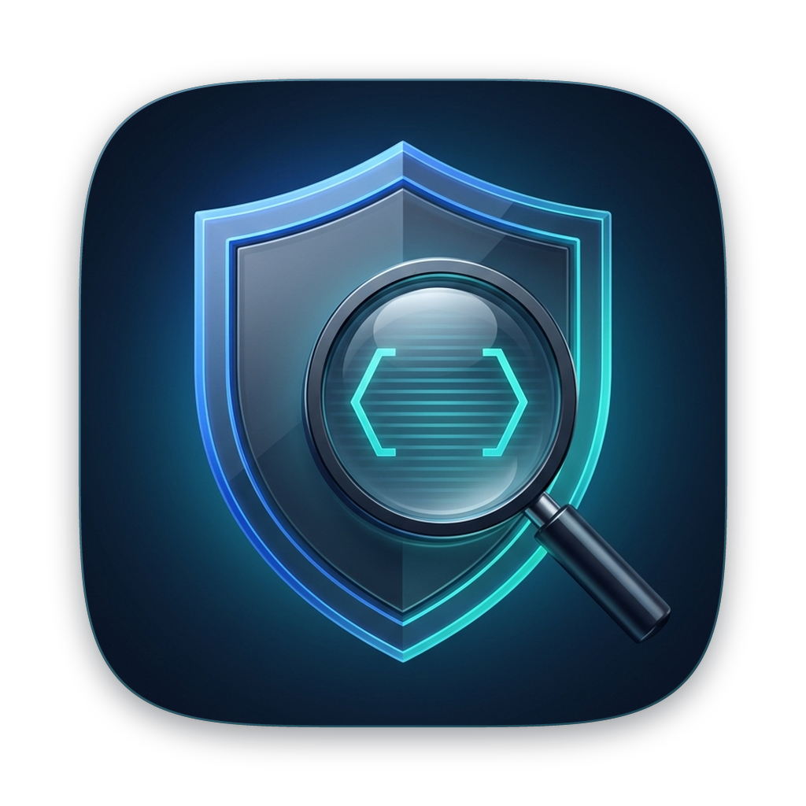
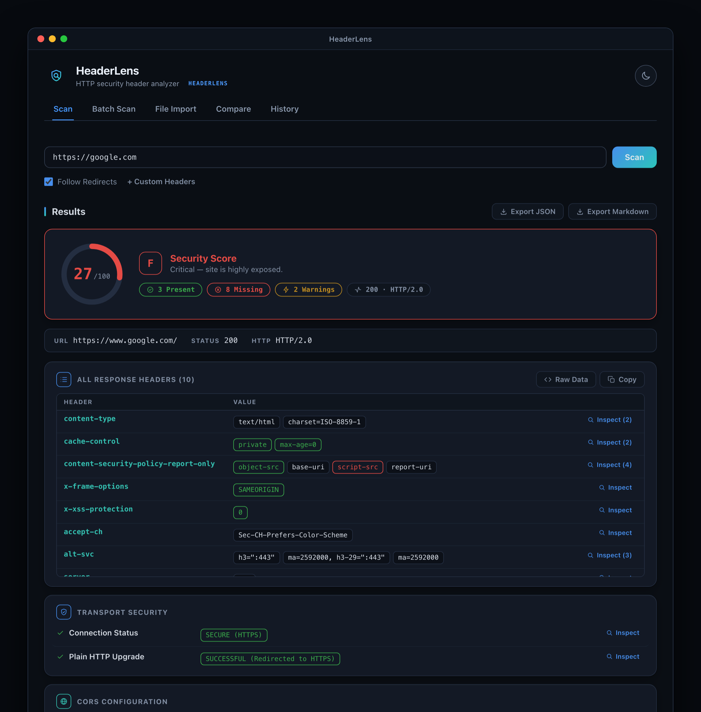

<p align="center">
  
</p>

<h1 align="center">HeaderLens</h1>

<p align="center">
  A sleek, lightweight, cross-platform desktop application for analyzing, auditing, and comparing HTTP response security headers.<br />
  Built with <strong>Tauri v2</strong> &amp; <strong>Rust</strong> on the backend and a zero-dependency <strong>HTML5 / CSS3 / JavaScript</strong> frontend.
</p>

<p align="center">
  
</p>

---

## Features

- **Single & Dual-Protocol URL Scan** — Enter a full URL (e.g., `https://google.com`) for a single deep inspection, or enter a bare domain (e.g., `google.com`) to automatically scan and compare **Plain HTTP vs. Encrypted HTTPS** side-by-side. Supports redirect following and custom request headers (`Authorization`, `Cookie`, etc.).
- **Interactive Block UI & Universal Header Inspector** — Every response header, directive, transport check, cookie flag, warning, and missing header is rendered as color-coded block chips. Click any item to open an interactive breakdown explaining each directive/parameter alongside copy-ready hardened configurations.
- **Raw HTTP Syntax View** — Toggle `All Response Headers` between structured Block Chips and a syntax-highlighted raw HTTP response viewer with status-code coloring and one-click copy.
- **Batch Domain & URL Scan** — Load target lists from `.txt` or `.csv` files (via file picker or drag-and-drop) or paste multiple targets. Bare domains automatically run dual `HTTP vs HTTPS` comparisons with live progress tracking and `Expand All` controls.
- **File & Raw Header Import** — Drag and drop `.txt` / `.headers` / `.http` files or paste raw HTTP responses directly for offline header, CORS, cookie, and info-leak analysis.
- **4 Side-by-Side Comparison Modes** — Compare header postures with an aligned `VS` scoreboard and live per-side `HTTP | HTTPS` protocol switcher tabs:
  - **URL vs. URL** (independent custom headers & protocol tabs per target)
  - **URL vs. File / Raw**
  - **URL vs. Scan History**
  - **History vs. History**
- **Grouped Scan History** — Persistent local scan log grouped by target URL with search filtering, multi-version timeline switching, and per-entry export.
- **Export Reports** — Export single, dual-protocol, batch, comparison, or historical reports to **JSON** or **Markdown**.
- **System-Aware Dark & Light Themes** — Automatically follows OS color scheme with instant manual theme override.

---

## Security Inspections

HeaderLens evaluates responses across five core areas:

1. **Transport Security** — HTTPS enforcement, TLS certificate validation, HTTP-to-HTTPS redirect verification, and `Strict-Transport-Security` (`max-age`, `includeSubDomains`, `preload`).
2. **Security Headers (11 Checks)** — `Strict-Transport-Security`, `Content-Security-Policy` (including directive-by-directive parsing and `frame-ancestors`), `X-Frame-Options` (`DENY` / `SAMEORIGIN`), `X-Content-Type-Options` (`nosniff`), `Referrer-Policy`, `Permissions-Policy`, `Cache-Control` (`no-store`), `Cross-Origin-Opener-Policy`, `Cross-Origin-Embedder-Policy`, `Cross-Origin-Resource-Policy`, and `X-XSS-Protection`.
3. **CORS Configuration** — Detects wildcard `*` origins, exploitable `null` origins, missing `Vary: Origin`, and critical `Access-Control-Allow-Origin: *` + `Access-Control-Allow-Credentials: true` misconfigurations.
4. **Cookie Hardening** — Audits `Set-Cookie` headers for missing `Secure`, `HttpOnly`, and `SameSite=Lax/Strict` attributes.
5. **Information Leaks** — Flags verbose server and infrastructure banners (`Server`, `X-Powered-By`, `X-AspNet-Version`, `X-Generator`, `X-Runtime`, `Via`, `X-Cache`, `CF-Ray`, `Server-Timing`).

---

## Tech Stack

- **Backend:** [Rust](https://www.rust-lang.org/), [Tauri v2](https://v2.tauri.app/), `reqwest` (`rustls-tls`), `tokio`, `serde` / `serde_json`
- **Frontend:** Vanilla HTML5, CSS3, and ES6+ JavaScript (100% offline, zero external runtime dependencies)
- **CI/CD:** GitHub Actions cross-platform release workflow producing `.dmg` (macOS arm64 & x64), `.deb` / `.AppImage` (Linux), and `.msi` / `.exe` (Windows)

---

## Getting Started

### Prerequisites

- **Rust** (stable toolchain via [rustup](https://rustup.rs/))
- **Platform dependencies for Tauri v2:** see the [Tauri Prerequisites Guide](https://v2.tauri.app/start/prerequisites/)

### Development & Build

1. Clone the repository:
   ```bash
   git clone https://github.com/NonBytes/HeaderLens.git
   cd HeaderLens
   ```

2. Install the Tauri CLI (if not already installed):
   ```bash
   cargo install tauri-cli --version "^2"
   ```

3. Run in development mode:
   ```bash
   cargo tauri dev
   ```

4. Build a production installer/bundle:
   ```bash
   cargo tauri build
   ```
   Output bundles are written to `src-tauri/target/release/bundle/`.
